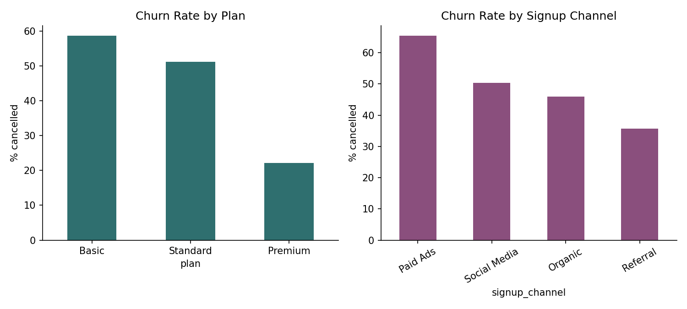
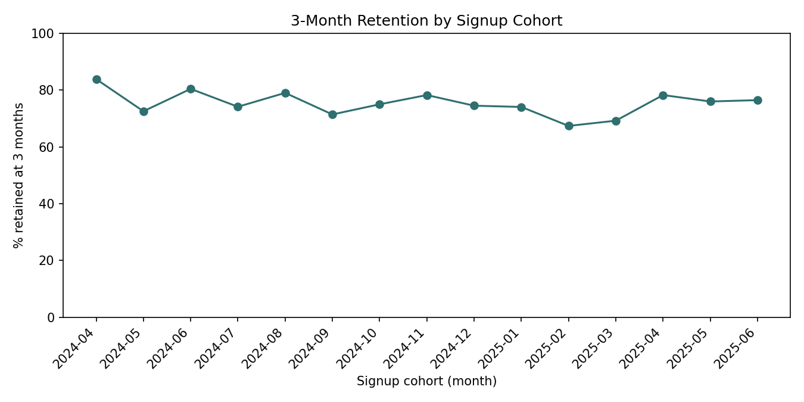

# Why We're Losing Subscribers — And What To Do About It

**To:** Head of Growth, SkillHub PH
**From:** Data Analysis
**Date:** September 2025
**Re:** Q2–Q3 2025 subscriber churn review

## Bottom line

Overall churn is 50.4% — roughly half of everyone who's ever subscribed
has cancelled. That number alone isn't actionable; the breakdown is.
Three things are driving it, each with a different fix, and one of them
is a decision we made ourselves in February.

## What's driving churn

**1. Paid acquisition is bringing in subscribers who don't stick.**
Customers acquired through Paid Ads churn at 65.4%, nearly double the
rate of Referral signups (35.6%). This isn't noise — the difference
across channels is statistically significant (χ² = 44.3, p < 0.001).
We're paying to acquire the customers least likely to stay, while the
cheapest channel (referral) retains best.

**2. The February price increase on the Standard plan measurably hurt
retention.** Looking only at subscribers who were already on the
Standard plan going into the increase, the 90-day cancellation rate
roughly doubled: 19.3% in the quarter before the change vs. 39.2% in
the quarter after (χ² = 10.9, p = 0.001). This is a direct, quantifiable
cost of that pricing decision, separate from any new-subscriber effect.

**3. Plan tier is the strongest single predictor of churn.** Basic
churns at 58.7%, Standard at 51.2%, Premium at just 22.2% (χ² = 58.4,
p < 0.001). Premium subscribers are categorically stickier — whether
that's because the plan delivers more value or because it self-selects
more committed users is worth investigating, but the pattern is too
large to be coincidence.

## Retention over time

3-month retention by signup cohort has hovered in the 70–80% range for
most of the project, with a visible dip for subscribers who signed up
in February and March 2025 (67–69%) — the same window as the price
increase, consistent with finding #2 above, though this view looks at
*new* signups rather than existing subscribers.

## Recommendations

1. **Shift acquisition spend away from Paid Ads, toward Referral.**
   Even a modest reallocation should improve blended retention without
   touching the product. This is the highest-confidence, lowest-risk
   recommendation in this memo.
2. **Revisit the Standard plan pricing decision, or pair it with a
   retention offer.** The post-increase churn spike is clean and
   statistically solid. If the price increase is staying, consider a
   win-back or loyalty offer specifically for Standard subscribers who
   were active before February.
3. **Investigate what Premium does differently.** Interview a sample of
   Premium subscribers, or compare feature usage across tiers, to find
   out whether the stickiness is about plan value or about who
   self-selects into it — then decide whether that's reproducible for
   Basic/Standard.

## Caveats

- `cancel_reason` is only captured on ~45% of cancellations (self-serve
  cancels often skip it), so this analysis is based on *behavior*
  (who cancels, when), not stated reasons. A reason-level breakdown
  would need better capture at the cancellation step first — see
  `docs/data_audit_notes.md`.
- The price-increase comparison is based on a 90-day before/after window
  with moderate sample sizes (114 and 143 at-risk subscribers). The
  direction and significance are solid; the exact magnitude should be
  treated as a reasonable estimate, not a precise figure.
- This analysis covers behavior through September 2025. Cohorts from
  the last 2–3 months don't yet have enough elapsed time to report a
  6-month retention figure — those will fill in over time (see
  `reports/cohort_retention.csv`).

---
*Full methodology, cleaning decisions, and reproducible SQL/Python are in
this project's repo — see `docs/data_audit_notes.md` and `scripts/`.*
